  <picture>
    <source media="(prefers-color-scheme: dark)" srcset="assets/lab-dark.svg">
    
  </picture>

# Hey, I'm Onur 👋

**AI Engineer & Mobile Developer** · Izmir / Remote · open to new roles

*I started out as a biologist; now my test subjects are AI models.* 
*Good news: none of them bite.*

---

### 🧬 What I do

I build AI systems people actually use: agents, OCR pipelines, speech and language model integrations, and the mobile apps they live in.

- At **Unimall** I automated an e-commerce operation of 22M+ product records across 3 sales channels; the OCR pipeline alone cut operating costs by 40%.
- At **Envagro** I benchmarked STT, TTS and LLM models under identical conditions, so model choices came from measurements instead of hunches.
- The lab habit stuck: assumptions get verified by measurement.

### 🚀 Featured projects

**[WeatherApp](https://github.com/Enver-Onur-Cogalan/WeatherApp)**: not what the weather is, but when to go out 
You set what you will actually go out in, and it finds the hours that clear all of it. The model that reads your question runs locally, on the machine you host it on. 
React Native (Expo) · TypeScript · Skia · FastAPI · Gemma 4B (Ollama) · Docker

**[Meme File](https://memefile.vercel.app)**: the right reaction video, while the moment is still funny 
A Windows library for reaction videos: tag clips with chips, find one in a second with full-text search, drag it straight into your chat app. Your files never move. 
Electron · React · TypeScript · SQLite (FTS5) · FFmpeg 
[Website](https://memefile.vercel.app) · [Download](https://github.com/Enver-Onur-Cogalan/meme-file/releases/latest) · [Code](https://github.com/Enver-Onur-Cogalan/meme-file)

**[Portfolio](https://enveronurcogalan.vercel.app)**: a chatbot that talks without an LLM 
My personal site: a microscope video you drive with the scroll wheel, a line-art version of me living my day, and a rule-based bilingual bot guarded by a 250+ case test set. Somewhere there is a hidden game. 
Next.js · React · TypeScript · Tailwind CSS · GSAP 
[Live](https://enveronurcogalan.vercel.app) · [Code](https://github.com/Enver-Onur-Cogalan/portfolio)

### 🧰 Stack

- **AI & language models**: LLM · RAG · AI agents · LangChain · LangGraph · Azure OpenAI · Local LLM (Ollama) · OCR · STT / TTS · Prompt engineering · Model benchmarking
- **Mobile**: React Native · Expo · React Native CLI · TypeScript · Skia · Reanimated · Drizzle ORM
- **Web & interface**: React · Next.js · Tailwind CSS · GSAP · Electron · Zustand · Streamlit
- **Backend & data**: Node.js · Python · FastAPI · API design · Socket.IO · FFmpeg · PostgreSQL · SQLite · MongoDB · Redis · Supabase · Firebase
- **Infrastructure & tools**: Docker · Microsoft Azure · Azure Blob Storage · Signed URL / SAS · Railway · Git · Webhooks & cronjobs · GitHub Actions (CI/CD)

### 📫 Let's connect

[Portfolio](https://enveronurcogalan.vercel.app) · [LinkedIn](https://www.linkedin.com/in/onurcogalan/) · [Medium](https://medium.com/@onurcogalan_96763) · [CV (EN)](https://enveronurcogalan.vercel.app/cv-en.pdf) · [Email](mailto:eonurcogalan@gmail.com)

Or ask the bot on my site. It won't make things up; it doesn't know how.
